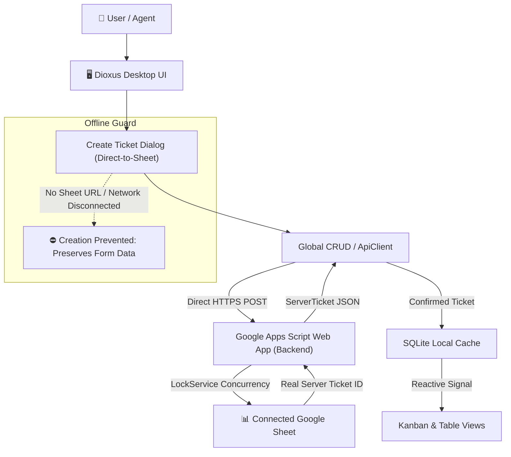

# Google Sheet Universal Schema & Global CRUD Specification

This document defines the standardized data structure and Universal CRUD protocol that connects the **Ticket & Task Management** desktop application to any Google Sheet.

---

## 1. Architectural Overview



### Core Tenet: Online-First Ticket Creation
- **No Orphan Offline Tickets**: Tickets cannot be created into an unlinked local vacuum. Every ticket is created and uploaded directly into the connected Google Sheet.
- **Immediate Server Confirmation**: The connected Google Sheet assigns the official ticket number (`IT-0145`), records the timestamps, and writes to the Google Sheet tab before confirming to the client.
- **Fail-Safe Client**: If network or Google Sheets connectivity fails, ticket creation is aborted with a clear diagnostic message, leaving the user's form input completely intact.

---

## 2. Standard Google Sheet Structure

Every Google Sheet connected to this application must have the following 4 standardized tabs (sheets). If any tab or column is missing, the Universal Apps Script automatically provisions or repairs it.

### Tab 1: `Tickets`
Stores IT support tickets and task items.

| Column Index | Column Header | Data Type | Description | Example Values |
|---|---|---|---|---|
| A | `Ticket ID` | String (Primary Key) | Auto-generated ticket identifier | `IT-0001`, `IT-0142` |
| B | `Employee Code` | String (Required) | Associated requester employee code | `11061`, `EMP042` |
| C | `Email Address` | String (Required) | Requester contact email | `chaitram@bpsl.com` |
| D | `Category` | String (Required) | Ticket category | `Hardware`, `Software`, `Network`, `General` |
| E | `Subject` | String (Required) | Issue summary / title | `Workstation monitor flickering` |
| F | `Problem Description`| String (Required) | Detailed problem description | `Display cuts out randomly...` |
| G | `Attachment Name` | String (Optional) | Uploaded attachment filename | `screenshot_error.png` |
| H | `Attachment URL` | String (Optional) | Google Drive shareable URL | `https://drive.google.com/...` |
| I | `Priority` | Enum | Ticket severity | `Low`, `Medium`, `High`, `Critical` |
| J | `Assigned to` | String | Support agent or team name | `IT Support`, `Devendra Patel` |
| K | `Customer` | String | Organization / division context | `Internal`, `BPSL Raipur` |
| L | `Time Spent` | Number | Hours spent on ticket | `0.5`, `2.0` |
| M | `Activities` | String | Log of chronological actions | `Replaced faulty cable` |
| N | `My Activity` | String | Current assigned agent action | `Testing signal coverage` |
| O | `Deadline` | String / Date | Target resolution time | `Tomorrow · 5:00 PM` |
| P | `SLA Status` | Enum | SLA compliance status | `Within SLA`, `Breached` |
| Q | `SLA Deadline` | String / Date | SLA SLA window description | `Within 24 Hours (P2)` |
| R | `Rating Avg Text` | String | Post-closure feedback | `5 Stars`, `Unrated` |
| S | `Kanban State` | Enum | High-level status | `Pending`, `InProgress`, `Hold`, `Solved`, `Completed`, `Cancelled` |
| T | `Stage` | Enum | Workflow stage | `Triage`, `In Progress`, `Hold`, `Resolved`, `Closed` |
| U | `Status` | Enum | Life-cycle status | `Open`, `Closed` |
| V | `Created on` | ISO Timestamp | Creation timestamp | `2026-11-21T14:30:00.000Z` |
| W | `Last Updated on` | ISO Timestamp | Last modification timestamp | `2026-11-21T14:35:00.000Z` |

---

### Tab 2: `Employees`
Serves as the internal employee directory.

| Column Index | Column Header | Data Type | Description | Example Values |
|---|---|---|---|---|
| A | `Employee Code` | String (Primary Key) | Unique employee identifier | `11061`, `11062` |
| B | `Name` | String | Full employee name | `Chaitram Sahu` |
| C | `Dept` | String | Department | `IT Support`, `HR`, `Operations` |
| D | `Division` | String | Location or plant division | `Raipur`, `Corporate Office` |
| E | `Mail` | String | Primary corporate email | `chaitram@bpsl.com` |

---

### Tab 3: `Reminders`
Automated scheduled reminder queue.

| Column Index | Column Header | Data Type | Description | Example Values |
|---|---|---|---|---|
| A | `Reminder ID` | String / Integer (PK)| Unique reminder identifier | `REM-0001` or `1` |
| B | `Employee Code` | String | Target employee code | `11061` |
| C | `Employee Name` | String | Target employee name | `Chaitram Sahu` |
| D | `Email Address` | String | Recipient email address | `chaitram@bpsl.com` |
| E | `Service Category` | String | Service category | `Hardware Follow-up` |
| F | `Reminder Message` | String | Notification body text | `Please confirm mouse replacement` |
| G | `Send At` | ISO Timestamp | Scheduled trigger time | `2026-11-22T09:00:00.000Z` |
| H | `Status` | Enum | Reminder status | `Pending`, `Sent`, `Cancelled` |
| I | `Email Sent At` | String | Dispatch timestamp | `Not sent yet`, `2026-11-22T09:01:00Z`|
| J | `Ticket ID` | String (Optional) | Associated ticket | `IT-0001` |
| K | `Created At` | ISO Timestamp | Creation timestamp | `2026-11-21T10:00:00.000Z` |
| L | `Last Updated At` | ISO Timestamp | Last update timestamp | `2026-11-21T10:00:00.000Z` |
| M | `CC Emails` | String | Comma-separated CC emails | `manager@bpsl.com` |
| N | `Repeat Frequency` | Enum | Cadence | `none`, `daily`, `weekly`, `monthly` |

---

### Tab 4: `Notes`
Private scratchpad and persistent operational notes.

| Column Index | Column Header | Data Type | Description | Example Values |
|---|---|---|---|---|
| A | `Note ID` | String / Integer (PK)| Unique note identifier | `NOTE-0001` or `1` |
| B | `Employee Code` | String | Creator employee code | `11061` |
| C | `Content` | String | Note body text | `Server maintenance scheduled for Sunday` |
| D | `Created At` | ISO Timestamp | Creation timestamp | `2026-11-21T12:00:00.000Z` |
| E | `Last Updated At` | ISO Timestamp | Last update timestamp | `2026-11-21T12:00:00.000Z` |
| F | `Is Deleted` | Integer / Boolean | Soft delete flag (0 = active, 1 = deleted) | `0` or `1` |

---

## 3. Global CRUD API Specification

The Google Apps Script backend implements universal CRUD endpoints accessible via `GET` and `POST` requests.

### Endpoint: `?api=crud`

#### 1. List Records (`action=list`)
- **Method**: `GET`
- **Query Params**:
  - `api=crud`
  - `sheet=<Tickets|Employees|Reminders|Notes>`
  - `action=list`
  - `offset=0` (optional, default: 0)
  - `limit=50` (optional, default: 50, max: 200)
  - `q=<search_text>` (optional)
- **Response**:
```json
{
  "success": true,
  "data": {
    "items": [ { ... } ],
    "total": 42,
    "offset": 0,
    "limit": 50,
    "has_more": false
  }
}
```

#### 2. Get Record by ID (`action=get`)
- **Method**: `GET`
- **Query Params**:
  - `api=crud`
  - `sheet=<SheetName>`
  - `action=get`
  - `id=<RecordID>`
- **Response**:
```json
{
  "success": true,
  "data": {
    "Ticket ID": "IT-0001",
    "Subject": "Workstation power supply failure",
    "Status": "Open"
  }
}
```

#### 3. Create Record (`action=create`)
- **Method**: `POST`
- **Query Params**:
  - `api=crud`
  - `sheet=<SheetName>`
  - `action=create`
- **Payload**:
```json
{
  "employee_code": "11061",
  "email_address": "chaitram@bpsl.com",
  "category": "Hardware",
  "subject": "Workstation power supply failure",
  "problem_description": "Desktop CPU not powering on",
  "priority": "High"
}
```
- **Response**:
```json
{
  "success": true,
  "data": {
    "Ticket ID": "IT-0001",
    "Employee Code": "11061",
    "Status": "Open",
    "Created on": "2026-11-21T14:30:00.000Z"
  }
}
```

#### 4. Update Record (`action=update`)
- **Method**: `POST`
- **Query Params**:
  - `api=crud`
  - `sheet=<SheetName>`
  - `action=update`
  - `id=<RecordID>`
- **Payload**: JSON dictionary containing only the fields to modify.
- **Response**: Updated object representation.

#### 5. Delete Record (`action=delete`)
- **Method**: `POST`
- **Query Params**:
  - `api=crud`
  - `sheet=<SheetName>`
  - `action=delete`
  - `id=<RecordID>`
- **Response**:
```json
{
  "success": true,
  "message": "Record 'IT-0001' deleted successfully."
}
```

---

## 4. Schema Verification & Auto-Initialization

### Verify Schema (`?api=schema&action=verify`)
Returns the health and structural conformance of all sheets:
```json
{
  "success": true,
  "data": {
    "valid": true,
    "spreadsheet_title": "IT Support TMS",
    "sheets": {
      "Tickets": {
        "exists": true,
        "total_rows": 24,
        "columns_found": ["Ticket ID", "Employee Code", "..."],
        "missing_columns": [],
        "is_valid": true
      }
    }
  }
}
```

### Auto-Initialize Schema (`?api=schema&action=init`)
Creates any missing tabs and prepends standard frozen header rows automatically.

---

## 5. Step-by-Step Connection Guide

1. **Create or Open your Google Sheet**.
2. Go to **Extensions > Apps Script**.
3. Replace all content in `Code.gs` with the script located at `scripts/GoogleAppsScript_Universal_TMS.js`.
4. Click **Deploy > New Deployment**.
   - Type: **Web app**
   - Execute as: **Me**
   - Who has access: **Anyone**
5. Click **Deploy**, approve Google permissions, and copy the **Web app URL**.
6. In the application:
   - Click the **Gear icon (Settings)** at the bottom-left sidebar.
   - Select the **API & Connection** tab.
   - Paste the Web App URL into **TMS Base URL**.
   - Click **Verify Sheet Structure** to confirm green checkmarks.
   - Done! All ticket creation, editing, and syncing is now connected live.

